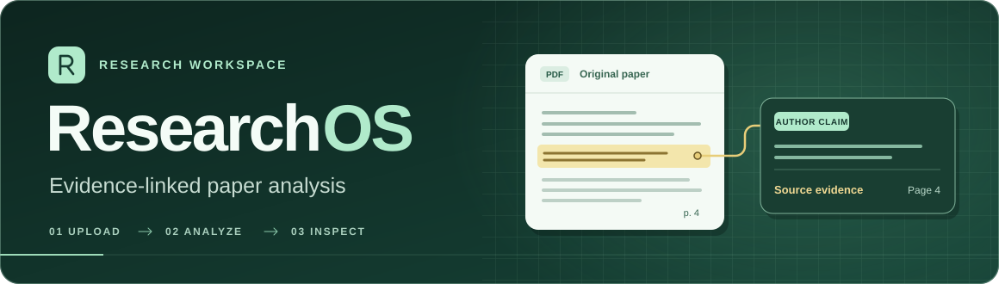
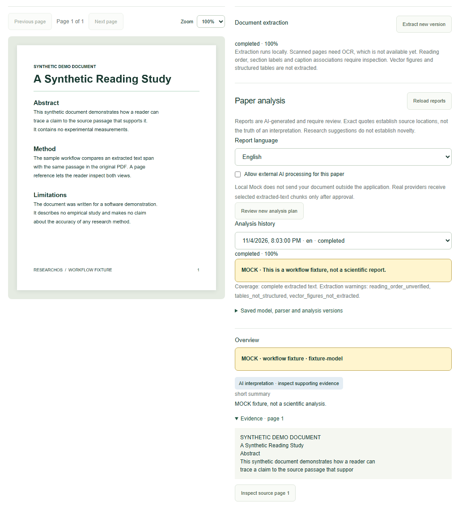
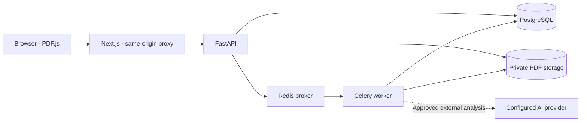

<h1 align="center">
  
</h1>

<p align="center"><strong>A private workspace for reading research papers and checking AI analysis against the source.</strong></p>

<p align="center">
  <a href="#quick-start">Quick start</a> ·
  <a href="#what-you-can-do">Features</a> ·
  <a href="#architecture">Architecture</a> ·
  <a href="docs/ROADMAP.md">Roadmap</a>
</p>

## From PDF to source evidence

Upload a paper, generate a structured report, and open the source page behind a claim. ResearchOS keeps the original PDF, extracted text, and report versions together so you can return to the same evidence later.

> [!NOTE]
> The core workflow is implemented and has been exercised locally with the built-in **Mock** provider, a real background worker, and persistent storage. Live AI connectivity with user credentials and scientific quality remain to be evaluated. See the [analysis checkpoint](docs/MILESTONE_05.md) and [provider verification record](docs/ADMIN_PANEL.md).

## What you can do

| Feature | What it does |
| --- | --- |
| **Private paper library** | Organize PDFs by project, search by title or filename, and preview the original in the browser. |
| **Versioned PDF extraction** | Extract page text, detected sections, metadata candidates, and embedded raster images in the background. Browse past extractions and jump to source pages. |
| **Structured analysis** | Generate reports in English or Persian covering the summary, methods, results, limitations, future work, research suggestions, and resources cited in the paper. |
| **Evidence inspection** | Distinguish author claims, model interpretations, and suggestions. Open exact quotes beside the PDF and revisit saved reports with their model and extraction versions. |
| **Provider controls** | Set personal model routes or an administrator-managed default. The admin panel can discover models and test a connection before activating it. |

<details>
<summary>Preview the paper and evidence side by side</summary>



Captured from a local run with a synthetic PDF and the built-in Mock provider.

</details>

## Quick start

**Requirements** · Docker with Linux containers and Compose v2 or later, plus Python 3.11 or later.

```sh
git clone https://github.com/parhamKIY/researchOS.git
cd researchOS
python scripts/bootstrap_env.py
docker compose up -d --build --wait --wait-timeout 180
docker compose exec api python -m researchos.cli create-admin --email you@example.com
```

Replace the example email and enter a password of at least 12 characters at the interactive prompt.

1. Sign in at [the admin panel](http://localhost:3000/admin). Choose **Mock · local fixture** and select **Test connection and apply**. This path needs no API key.
2. Open [the workspace](http://localhost:3000), create and select a project, then upload a PDF with selectable text.
3. Open the paper after extraction, choose a report language, and select **Review new analysis plan**. Approve the listed destinations and select **Start analysis**.
4. Expand an evidence entry in the report and select **Inspect source page**. Use **Analysis history** to reopen saved reports.

Mock uses local test fixtures and labels its output. To configure Gemini or an OpenAI-compatible Chat Completions endpoint, follow the [administrator guide](docs/ADMIN_PANEL.md). For a regular account, use the CLI's `create-user` command.

## Architecture



The application uses TypeScript and Next.js for the workspace, Python and FastAPI for the API, and SQLAlchemy and Alembic for persistence and migrations. Celery runs extraction and analysis in the background. PostgreSQL tracks job state and versions, and Docker Compose runs the stack locally. See the [architecture notes](docs/ARCHITECTURE.md) and [data model](docs/DATA_MODEL.md).

## Data handling and current limits

- **Documents and credentials.** Files are stored in a private volume and access is scoped to the owner. Provider keys are encrypted server-side. External analysis requires permission for the paper and approval of the exact model destinations. Providers receive selected chunks of extracted text.
- **PDF coverage.** The parser works with text-layer PDFs and embedded raster images. OCR, structured table extraction, and vision analysis are outside the current release. Analysis reports disclose when long documents are sampled.
- **Scientific review.** Exact quotes help you locate evidence. Assess whether the source supports each interpretation before relying on a report or research suggestion.
- **Deployment scope.** The supplied Compose stack binds the web UI to loopback for local use. Public deployment hardening and backup procedures are roadmap work. Preserve the credential encryption key with any database backup.

## Development

| I want to… | Start here |
| --- | --- |
| Configure the stack or run host-side checks | [Local development guide](docs/DEVELOPMENT.md) · [Environment template](.env.example) |
| Explore endpoints and payloads | [Local Swagger UI](http://localhost:3000/api/docs) · [API contract](docs/API_CONTRACT.md) |
| Run integration tests against the local stack | `docker compose --profile test run --build --rm tests` |
| See how extraction was evaluated | [Parser evaluation](docs/PARSER_EVALUATION.md) |
| See what comes next | [Roadmap](docs/ROADMAP.md) · [Project specification](docs/PROJECT_SPEC.md) |

The next planned milestone adds retrieval and chat scoped to a paper or project. Cross-paper comparison and broader literature discovery follow in later milestones.
