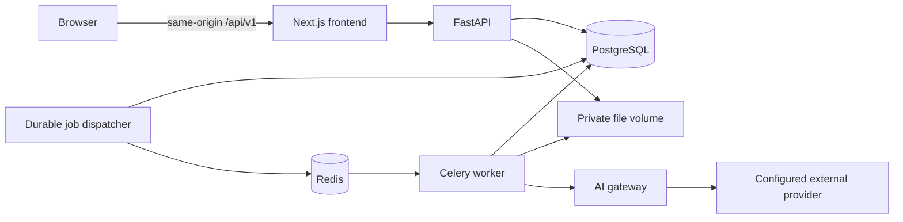

# Architecture decisions — initial release

Status: approved implementation plan; foundation components are implemented. See [development instructions](DEVELOPMENT.md) for current scope and execution checks.
Related contracts: [data model](DATA_MODEL.md), [API](API_CONTRACT.md), [roadmap](ROADMAP.md).

## Release boundary

One locally provisioned account can sign in, manage projects, upload English scientific PDFs, configure a provider/model, request an English or Persian analysis, inspect page evidence and extracted figures, and revisit saved reports.

Ownership and authentication are mandatory even in the local release. Public registration, multi-user hosting, DOI imports, RAG, guaranteed table extraction, vision analysis, and novelty assessment are outside this release. Unsupported document features and unavailable report sections are explicitly identified.

The first provider adapter must perform real structured text analysis when credentials are configured. A separate mock adapter produces clearly marked fixture responses for development/tests. Mock output cannot be represented as scientific analysis. Parser selection requires a small extraction-quality, licensing, and resource-use assessment before integration.

## Runtime topology



API, dispatcher, and worker use one backend package and database, deployed as separate processes in Docker Compose. The dispatcher publishes durable queued jobs; it is not an independent service codebase. Only the web entry point is exposed by default. Provider secrets and private files remain server-side. Redis is a broker, not the source of job/report truth.

## Decisions and trade-offs

| Decision | Rationale | Cost / alternative |
|---|---|---|
| Modular monolith | One domain, migrations, and deployment to maintain | Worker resource limits remain independent; split services only after measured need |
| Python/FastAPI | Shared API, parsing, and ML ecosystem | CPU-heavy work runs outside request handlers; other languages require a measured need |
| Next.js/TypeScript | Typed, interactive document workspace | Adds a frontend runtime; develop UI alongside each backend capability |
| PostgreSQL + SQLAlchemy/Alembic | Durable relational ownership and versioning | Real database integration checks are required; SQLite is not an integration substitute |
| Redis/Celery | Separate long jobs from web requests | Delivery can duplicate; database claims and stage checkpoints are required |
| Opaque server sessions | Revocable authentication for a browser-first app | Cookie authentication needs CSRF controls; no JWT rotation system in the initial release |
| Local private file store | Practical local operation | Shared API/worker volume and orphan cleanup required; storage interface permits S3 later |
| Provider interface | Runtime selection without business logic depending on an SDK | Evaluate LiteLLM library vs small native adapters during provider implementation |
| Page/section evidence before RAG | Grounding works in the first release | Long documents need section processing and context limits before vector retrieval exists |

Exact dependency versions will be selected, locked, and tested during foundation implementation. No speculative performance claim is implied by these choices.

## Planned repository structure

```text
backend/
  pyproject.toml
  src/researchos/
    api/                 # Routers, dependencies, request/response schemas
    core/                # Configuration, authentication, encryption, redaction
    domain/              # Models, typed states, evidence and report contracts
    services/            # Projects, papers, analysis, provider settings
    infrastructure/      # SQLAlchemy repositories, file storage, broker
    processing/          # Parser adapters and document pipeline
    ai/                  # Provider interface, gateway, adapters
    tasks/               # Celery tasks and durable dispatcher
  migrations/
  tests/                 # Unit and PostgreSQL integration tests
frontend/
  src/app/               # Routes and document workspace
  src/components/
  src/lib/               # Typed API client and session handling
  tests/
tests/e2e/               # Full browser workflows
docs/
.github/workflows/
compose.yaml
.env.example
```

These directories are created when their first implementation exists. Retrieval and external academic discovery modules are added in their roadmap phases.

## Authentication and private access

- Provision the first account through a backend CLI; no public signup endpoint.
- Store a password hash, never a password. Session tokens are cryptographically random and stored only as hashes. Derive the CSRF token with HMAC from the incoming session token and a server-held secret, store its hash, and compare in constant time. This lets session reads reproduce the CSRF token without storing it in plaintext.
- The browser receives a host-only HttpOnly session cookie with SameSite=Lax. Secure is mandatory outside explicitly configured localhost HTTP development.
- Login requires JSON and an allowed Origin. Authenticated state-changing requests additionally require the session's `X-CSRF-Token`; logout revokes the session.
- Proxy `/api/v1` through the web origin. Do not enable wildcard credentialed CORS. Validate configured public origin and forwarded headers from trusted infrastructure only.
- Resolve ownership inside every service/repository query, including file download, evidence, job, and settings queries. Another user's resource is indistinguishable from an absent resource (404).
- Rate-limit login and job submission; do not log credentials, cookies, document text, or provider payloads.

These controls follow the [OWASP CSRF guidance](https://cheatsheetseries.owasp.org/cheatsheets/Cross-Site_Request_Forgery_Prevention_Cheat_Sheet.html); their implementation must be tested before private resources are enabled.

## Document and analysis workflow

1. Authenticate, authorize the optional project, validate size/signature, and stream the upload to a generated private path. Do not use the supplied filename as a storage path.
2. Hash the bytes; reuse an existing paper only within the same owner. Link it to the selected project without triggering duplicate analysis.
3. Commit paper/file/document-version and queued ingestion job together. Reconcile abandoned temporary files and failed database writes.
4. Dispatcher publishes only the job ID after commit. Worker claims a lease in PostgreSQL; duplicate deliveries cannot concurrently process the same job.
5. Parse with resource/time limits. Preserve page text, section boundaries, images, parser version, and extraction warnings. A failed parse does not erase the uploaded source.
6. When analysis is requested, freeze the document version, selected model configuration, provider credential revision, prompt/schema version, language, and parameters into a secret-free job snapshot.
7. Build bounded section context. Documents are untrusted source material. Do not run document instructions, tools, embedded scripts, or discovered URLs.
8. Gateway verifies model capability, current provider authorization/revision, paper privacy policy, and any configured limit before decrypting credentials and making a request.
9. Validate the structured report and evidence references. A source-statement claim needs a matching source span; inferred claims must be labeled and linked to supporting evidence. Reference validity is not proof of semantic truth.
10. Persist report sections, claims, evidence links, usage, and terminal job status. Display the report alongside the original PDF with page navigation.

Successful analysis sections survive another section's failure. Unavailable data, extraction failure, unsupported capability, and insufficient evidence have different reason codes. Reports are immutable; re-analysis creates a new version.

## Reliability and cost

Celery does not provide exactly-once execution; tasks need [idempotency and bounded timeouts](https://docs.celeryq.dev/en/stable/userguide/tasks.html). Job publication can repeat safely under the database lease. Job rows double as the initial durable dispatch queue, avoiding a separate general-purpose event bus.

- Checkpoint parsing and each validated report section. A unique analysis-per-job constraint prevents duplicate reports.
- Persist provider request intent before sending. Record success, known failure, or unknown outcome with attempt and request fingerprints.
- Retry only safe known failures, using bounded backoff and any provider retry headers. An ambiguous paid-call outcome is not automatically replayed unless provider idempotency is supported; require an explicit retry decision.
- Recover expired leases. State/checkpoint writes require the current lease token, preventing a stale worker from overwriting another attempt. A previously started AI request with no durable result becomes `outcome_unknown`; do not treat it as an unused request.
- Revoked or changed credentials stop queued work rather than silently changing its provider configuration. A fallback requires explicit allowed-provider configuration and capability/privacy checks.
- Store nullable token counts and nullable costs. Unknown cost is not zero; a configured monetary budget rejects requests whose conservative upper bound cannot be established.
- Start with constrained worker concurrency. Use measured latency/memory/cost before tuning or adding another language.

## Implementation acceptance trace

| User action | Contract | Persistent records |
|---|---|---|
| Sign in | `POST /auth/login` | User, AuthSession |
| Create project | `POST /projects` | ResearchProject |
| Configure provider/model | Provider/model/settings endpoints | ProviderConnection, ModelConfiguration, ModelRoutingRule |
| Upload PDF | `POST /papers/upload` | Paper, PaperFile, PaperProject, DocumentVersion, ProcessingJob |
| Follow extraction | `GET /jobs/{job_id}` | ProcessingJob, DocumentPage, PaperSection, PaperFigure |
| Start analysis | `POST /papers/{paper_id}/analyses` | ProcessingJob with frozen configuration |
| Inspect report/evidence | Analysis/evidence endpoints | AnalysisReport, ReportSection, ResearchClaim, SupportingEvidence |
| Revisit later | Paper and analysis reads | Same retained versions; no regeneration required |

All paths above use the `/api/v1` prefix. The complete route and payload definitions are in the [API contract](API_CONTRACT.md).

## Stage 0 completion and next increment

Architecture, data ownership/versioning, API payloads, and the end-to-end acceptance trace are designed. This is design completion, not implementation or runtime verification.

The runnable frontend/backend foundation, validated configuration, PostgreSQL identity migration, broker/worker connectivity, Compose, and CI configuration now exist. Local execution checks are recorded in `docs/DEVELOPMENT.md`; remote CI execution is not yet verified.

Next: account provisioning, session authentication and CSRF controls, owned research projects, and the first persistent paper-library workflow. Defer README updates until the application is complete.
