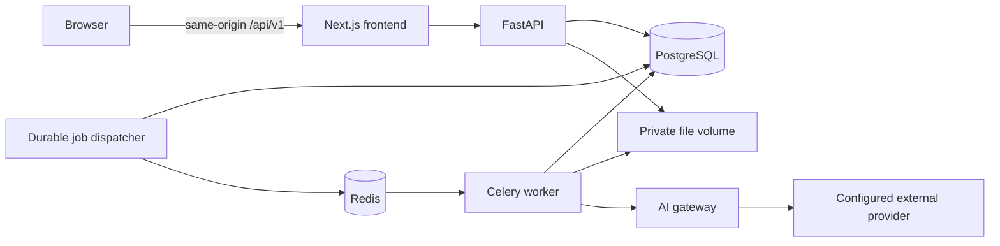

# Architecture decisions — initial release

Status: foundation, private library, versioned extraction, provider settings, administration and stage 5 evidence-linked analysis are implemented. The complete workflow is verified with a labeled mock. Successful real-provider analysis and scientific quality evaluation remain pending. See [development instructions](DEVELOPMENT.md) and [stage 5 evidence/limits](MILESTONE_05.md).
Related contracts: [data model](DATA_MODEL.md), [API](API_CONTRACT.md), [roadmap](ROADMAP.md).

## Release boundary

One locally provisioned account can sign in, manage projects, upload English scientific PDFs, configure a provider/model, request an English or Persian analysis, inspect page evidence and extracted figures, and revisit saved reports.

Ownership and authentication are mandatory even in the local release. Public registration, multi-user hosting, DOI imports, RAG, guaranteed table extraction, vision analysis, and novelty assessment are outside this release. Unsupported document features and unavailable report sections are explicitly identified.

The first provider adapter must perform real structured text analysis when credentials are configured. A separate mock adapter produces clearly marked fixture responses for development/tests. Mock output cannot be represented as scientific analysis. Parser selection requires a small extraction-quality, licensing, and resource-use assessment before integration.

## Runtime topology



API, maintenance, and worker use one backend package and database, deployed as separate processes in Docker Compose. Maintenance dispatches durable queued jobs and recovers expired worker leases every five seconds; private file cleanup runs once per minute. Only the web entry point is exposed by default. Private files remain server-side. Redis is a broker, not the source of job/report truth.

The stage 2 frontend renders PDF pages with bundled PDF.js assets (Apache-2.0), without document scripting or interactive annotations. This browser display library is separate from selecting a backend extraction parser. Uploads use a bounded raw PDF body rather than multipart; see the implemented [API boundary](API_CONTRACT.md).

## Decisions and trade-offs

| Decision | Rationale | Cost / alternative |
|---|---|---|
| Modular monolith | One domain, migrations, and deployment to maintain | Worker resource limits remain independent; split services only after measured need |
| Python/FastAPI | Shared API, parsing, and ML ecosystem | CPU-heavy work runs outside request handlers; other languages require a measured need |
| Next.js/TypeScript | Typed, interactive document workspace | Adds a frontend runtime; develop UI alongside each backend capability |
| PostgreSQL + SQLAlchemy/Alembic | Durable relational ownership and versioning | Real database integration checks are required; SQLite is not an integration substitute |
| Redis/Celery | Separate long jobs from web requests | Delivery can duplicate; database claims and stage checkpoints are required |
| Opaque server sessions | Revocable authentication for a browser-first app | Cookie authentication needs CSRF controls; no JWT rotation system in the initial release |
| Local private file store | Practical local operation | Shared API/worker volume and orphan cleanup required; storage interface permits S3 later |
| Provider interface | Runtime selection without business logic depending on an SDK | Evaluate LiteLLM library vs small native adapters during provider implementation |
| Page/section evidence before RAG | Grounding works in the first release | Long documents need section processing and context limits before vector retrieval exists |

Exact dependency versions will be selected, locked, and tested during foundation implementation. No speculative performance claim is implied by these choices.

## Planned repository structure

```text
backend/
  pyproject.toml
  src/researchos/
    api/                 # Routers, dependencies, request/response schemas
    core/                # Configuration, authentication, encryption, redaction
    domain/              # Models, typed states, evidence and report contracts
    services/            # Projects, papers, analysis, provider settings
    infrastructure/      # SQLAlchemy repositories, file storage, broker
    processing/          # Parser adapters and document pipeline
    ai/                  # Provider interface, gateway, adapters
    tasks/               # Celery tasks and durable dispatcher
  migrations/
  tests/                 # Unit and PostgreSQL integration tests
frontend/
  src/app/               # Routes and document workspace
  src/components/
  src/lib/               # Typed API client and session handling
  tests/
tests/e2e/               # Full browser workflows
docs/
.github/workflows/
compose.yaml
.env.example
```

These directories are created when their first implementation exists. Retrieval and external academic discovery modules are added in their roadmap phases.

## Authentication and private access

- Provision the first account through a backend CLI; no public signup endpoint.
- Store a password hash, never a password. Session tokens are cryptographically random and stored only as hashes. Derive the CSRF token with HMAC from the incoming session token and a server-held secret, store its hash, and compare in constant time. This lets session reads reproduce the CSRF token without storing it in plaintext.
- The browser receives a host-only HttpOnly session cookie with SameSite=Lax. Secure is mandatory outside explicitly configured localhost HTTP development.
- Login requires JSON and an allowed Origin. Authenticated state-changing requests additionally require the session's `X-CSRF-Token`; logout revokes the session.
- Proxy `/api/v1` through the web origin. Do not enable wildcard credentialed CORS. Validate configured public origin and forwarded headers from trusted infrastructure only.
- Resolve ownership inside every service/repository query, including file download, evidence, job, and settings queries. Another user's resource is indistinguishable from an absent resource (404).
- Rate-limit login and job submission; do not log credentials, cookies, document text, or provider payloads.

These controls follow the [OWASP CSRF guidance](https://cheatsheetseries.owasp.org/cheatsheets/Cross-Site_Request_Forgery_Prevention_Cheat_Sheet.html); their implementation must be tested before private resources are enabled.

## Document and analysis workflow

1. Authenticate, authorize the optional project, validate size/signature, and stream the upload to a generated private path. Do not use the supplied filename as a storage path.
2. Hash the bytes; reuse an existing paper only within the same owner. Link it to the selected project without triggering duplicate analysis.
3. Commit paper/file/document-version and queued ingestion job together. Reconcile abandoned temporary files and failed database writes.
4. Dispatcher publishes only the job ID after commit. Worker claims a lease in PostgreSQL; duplicate deliveries cannot concurrently process the same job.
5. Parse with resource/time limits. Preserve page text, section boundaries, images, parser version, and extraction warnings. A failed parse does not erase the uploaded source.
6. When analysis is requested, freeze the document version, selected model configuration, provider credential revision, prompt/schema version, language, and parameters into a secret-free job snapshot.
7. Build bounded section context. Documents are untrusted source material. Do not run document instructions, tools, embedded scripts, or discovered URLs.
8. Gateway verifies model capability, current provider authorization/revision, paper privacy policy, and any configured limit before decrypting credentials and making a request.
9. Validate the structured report and evidence references. A source-statement claim needs a matching source span; inferred claims must be labeled and linked to supporting evidence. Reference validity is not proof of semantic truth.
10. Persist report sections, claims, evidence links, usage, and terminal job status. Display the report alongside the original PDF with page navigation.

Successful analysis sections survive another section's failure. Unavailable data, extraction failure, unsupported capability, and insufficient evidence have different reason codes. Reports are immutable; re-analysis creates a new version.

## Reliability and cost

Celery does not provide exactly-once execution; tasks need [idempotency and bounded timeouts](https://docs.celeryq.dev/en/stable/userguide/tasks.html). Job publication can repeat safely under the database lease. Job rows double as the initial durable dispatch queue, avoiding a separate general-purpose event bus.

- Checkpoint parsing and each validated report section. A unique analysis-per-job constraint prevents duplicate reports.
- Persist provider request intent before sending. Record success, known failure, or unknown outcome with attempt and request fingerprints.
- Retry only safe known failures, using bounded backoff and any provider retry headers. An ambiguous paid-call outcome is not automatically replayed unless provider idempotency is supported; require an explicit retry decision.
- Recover expired leases. State/checkpoint writes require the current lease token, preventing a stale worker from overwriting another attempt. A previously started AI request with no durable result becomes `outcome_unknown`; do not treat it as an unused request.
- Revoked or changed credentials stop queued work rather than silently changing its provider configuration. A fallback requires explicit allowed-provider configuration and capability/privacy checks.
- Store nullable token counts and nullable costs. Unknown cost is not zero; a configured monetary budget rejects requests whose conservative upper bound cannot be established.
- Start with constrained worker concurrency. Use measured latency/memory/cost before tuning or adding another language.

## Implementation acceptance trace

| User action | Contract | Persistent records |
|---|---|---|
| Sign in | `POST /auth/login` | User, AuthSession |
| Create project | `POST /projects` | ResearchProject |
| Configure provider/model | Provider/model/settings endpoints | ProviderConnection, ModelConfiguration, ModelRoutingRule |
| Upload PDF | `POST /papers/upload` | Paper, PaperFile, PaperProject, DocumentVersion, ProcessingJob |
| Follow extraction | `GET /jobs/{job_id}` | ProcessingJob, DocumentPage, PaperSection, PaperFigure |
| Start analysis | `POST /papers/{paper_id}/analyses` | ProcessingJob with frozen configuration |
| Inspect report/evidence | Analysis/evidence endpoints | AnalysisReport, ReportSection, ResearchClaim, SupportingEvidence |
| Revisit later | Paper and analysis reads | Same retained versions; no regeneration required |

All paths above use the `/api/v1` prefix. The complete route and payload definitions are in the [API contract](API_CONTRACT.md).

## Stage 0 completion and next increment

Architecture, data ownership/versioning, API payloads, and the end-to-end acceptance trace are designed. This is design completion, not implementation or runtime verification.

The runnable frontend/backend foundation, validated configuration, PostgreSQL identity migration, broker/worker connectivity, Compose, and CI configuration now exist. Local execution checks are recorded in `docs/DEVELOPMENT.md`; remote CI execution is not yet verified.

Local provisioning, session authentication/CSRF, owned projects, private PDFs, asynchronous extraction and provider settings now work. Next: verify a live Gemini connection, then implement evidence-grounded analysis. Defer README updates until the application is complete.

## Implemented provider boundary

Provider connections and models are private, versioned server-side records. Keys use AES-256-GCM with a fresh nonce and owner/provider/version-associated data; the independent encryption key is held in local server configuration. Read schemas return only a constant credential status. Replacement increments the credential revision; clearing/deleting removes stored ciphertext. Provider deletion is soft so model/usage history survives. Server key rotation/reencryption is not yet implemented: preserve the encryption key with database backups.

The first live adapter targets Gemini's fixed HTTPS REST endpoint; arbitrary URLs and redirects are rejected. HTTPX is already a locked application dependency, and the small text-provider interface also supports an explicitly labeled local mock. [LiteLLM's SDK](https://docs.litellm.ai/docs/python_sdk) was assessed for its broad provider coverage; introducing that integration layer does not simplify this initial single-live-provider slice. No proxy service or model-name capability inference was added. New providers can implement the same interface.

Models declare text, vision and embedding capabilities with source `manual`. Generation parameters are a strict bounded schema. Task routing atomically saves primary and optional fallback models and the exact explicitly allowed provider set; all models/providers are revalidated when resolved. This milestone configures future task routes; document analysis, automatic fallback execution, vision, embeddings and chat remain later work.

Connectivity testing sends one fixed public message, never a paper, using the selected saved model and its current parameters. Output tokens are capped at 256 for the test. The adapter has bounded response size and timeouts and normalizes errors without exposing upstream bodies. Only an explicit 429 or connection failure permits one retry after 0.5 seconds. Ambiguous read/write timeouts and server outcomes are recorded without automatic retry. Each attempt records safe provider/model snapshots, latency, available token counts (including thought/total tokens) and nullable cost. The mock reports synthetic counts and zero provider charge; Gemini cost stays unknown because the implemented response does not supply billing cost.

Contract sources: [Gemini generateContent](https://ai.google.dev/api/generate-content), [API key handling](https://ai.google.dev/gemini-api/docs/api-key), [model metadata](https://ai.google.dev/api/models). Successful calls in HTTP transport fixtures do not establish successful live-provider connectivity. Local verification and limits are recorded in [stage 4](MILESTONE_04.md).

## Implemented administrator extension

The `/admin` panel manages account status and the global default text provider. Administrator dependencies check the live stored role; CSRF/origin and revision checks guard mutations. Initial roles use `create-admin` / `grant-admin` CLI commands. Counts and account status do not grant access to another user's private papers or keys.

System candidates are encrypted under a separate authenticated context. The application commits a pending candidate before external I/O without changing the active pointer. A successful bounded text probe rechecks role/session and compares the global revision before atomic activation. Failures/stale tests retain the active configuration and erase candidate keys. Superseded keys are also erased; maintenance recovers pending probes older than five minutes. The text resolver prefers explicit personal routes and otherwise snapshots the active system default. Stage 5 separately implements document consent and per-report usage accounting.

The compatible adapter uses Chat Completions with a configurable public HTTPS API base. It rejects private/mixed DNS answers and pins the validated IP at TCP connect while retaining hostname verification/SNI. Redirects and environment proxies are disabled. Gemini keeps its official fixed endpoint; mock remains explicitly local. API key reuse is limited to the identical protocol and endpoint, and admin probes never retry automatically. Test/verification details are in [the admin checkpoint](ADMIN_PANEL.md).

Protocol references: [Chat Completions](https://developers.openai.com/api/reference/resources/chat/subresources/completions/methods/create), [HTTPX transports](https://www.python-httpx.org/advanced/transports/), [HTTPCore network backends](https://www.encode.io/httpcore/network-backends/), [SSRF prevention](https://cheatsheetseries.owasp.org/cheatsheets/Server_Side_Request_Forgery_Prevention_Cheat_Sheet.html).

## Implemented stage 5 analysis boundary

Analysis uses a separate `AnalysisReport` durable state machine and section/attempt tables. Plans fingerprint extraction/context, language, prompt/schema versions and exact model/provider revisions. One active report per owned paper, owner-scoped idempotency and hourly limits guard creation. External calls require both paper privacy permission and explicit approval of every reviewed primary/fallback configuration.

Context consists of bounded page chunks with stable page/section/code-point references. Long inputs use declared sampling, not hidden full-document coverage or RAG. A versioned JSON instruction envelope treats source text as untrusted data. Strict typed outputs separate author claims, interpretations and suggestions. Published witnesses match immutable owned text exactly; quantitative fields and URLs must occur in evidence. Research suggestions explicitly separate proposed methods/resources and estimates from uncertainty. These checks establish provenance and format, not semantic correctness, extraction accuracy or scientific novelty.

Workers record attempts before I/O, recheck configuration/privacy, and commit each validated section independently. Actual mode/model/configuration/attempt provenance is attached server-side to each successful section. Provider credentials reflected into decoded output are rejected. Raw invalid responses, keys and prompts never enter task broker payloads or usage logs. The broker carries only report UUIDs.

Only approved fallback models run after definite upstream rejection/rate/connect failures. Invalid output and ambiguous outcomes are not automatically replayed. Lease recovery preserves published parts and turns interrupted started attempts into unknown outcomes; it never requeues a paid analysis. Explicit retries create a full new report, with uncertainty acknowledgment when required. The UI exposes progress, versions, per-request usage and exact source inspection beside the PDF. Real-provider and scientific evaluation remain separate pending work.

## Implemented extraction boundary

The replaceable parser contract is implemented with locked pypdf, pdfplumber and Pillow. Selection evidence and licensing are in [the parser evaluation](PARSER_EVALUATION.md). The full Docling ML/OCR pipeline is not installed or benchmarked. Page text, heuristic heading spans, PDF-info metadata/DOI candidates and embedded raster images retain page/version provenance. Captions are explicitly candidates, and metadata is unverified. OCR, vector drawings and structured tables are unavailable.

Each new upload creates its job and document version in the same database transaction. Explicit re-extraction and failed-job retry are CSRF-protected and replayable; a retry creates a fresh version. A worker claims a lease, verifies the original file hash and frozen parser identity, then runs extraction in a subprocess with a scrubbed environment, wall timeout and Linux address-space/CPU/output-file limits. This is process/resource isolation, not an OS security sandbox; Windows host execution has no Unix resource limits. No provider is called.

Page publication is one database transaction with version/owner/offset checks and compensating image cleanup. A guarded heartbeat and lease token fence stale workers; duplicate messages cannot publish twice. An expired job is requeued up to three claimed attempts before failure. Original and extracted files remain private. The UI polls actual job state, keeps old versions selectable and connects text/section/image references to the original PDF page. Offsets count Unicode code points, with zero-based inclusive start and exclusive end.
